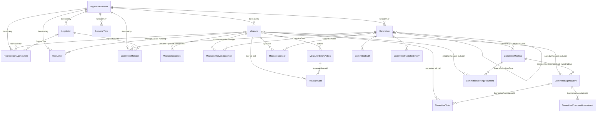

# Oregon Legislature OLIS OData feed: what it provides and what caching a session takes

Researched 2026-10-28 (live queries run 2026-10-28 21:40 to 22:30 Pacific; the response `Date` headers read `Thu, 29 Oct 2026 04:4x GMT`).

Labels used below:

- **verified**: I fetched the URL and saw the fact in the response.
- **inferred**: my reading of verified evidence, not stated by the source.

The feed is `B = https://api.oregonlegislature.gov/odata/odataservice.svc`. Every query URL below is relative to `B`. Counts are for session `2025R1` unless a different session is named.

---

## 1. Access

| Item                    | Finding                                                                                                                                                                                                                                                                                                                                                                                                                                                                 | Status                                               | Source                                                                      |
| ----------------------- | ----------------------------------------------------------------------------------------------------------------------------------------------------------------------------------------------------------------------------------------------------------------------------------------------------------------------------------------------------------------------------------------------------------------------------------------------------------------------- | ---------------------------------------------------- | --------------------------------------------------------------------------- |
| Entry page              | "Open Data - Measure, Committee, District, and Legislator Information Available to the Public". It says the OData API "provides complete and up-to-date session information" and links to the base endpoint, `$metadata`, an Acceptable Use Agreement, and a data-model PDF.                                                                                                                                                                                            | verified                                             | https://www.oregonlegislature.gov/citizen_engagement/Pages/data.aspx        |
| Service root            | `https://api.oregonlegislature.gov/odata/odataservice.svc/`. The AtomPub service document lists 20 collections, and `xml:base` is `.../odata/ODataService.svc/`. The path is case-insensitive: both casings work.                                                                                                                                                                                                                                                       | verified                                             | `B/`                                                                        |
| Implementation          | WCF Data Services on IIS 10 / ASP.NET 4.0. Headers: `server: Microsoft-IIS/10.0`, `x-aspnet-version: 4.0.30319`. The error stack traces name `Microsoft.Data.OData`.                                                                                                                                                                                                                                                                                                    | verified                                             | `B/`, `B/Measures?$filter=Nope eq 1`                                        |
| OData version           | **OData v1–v3, not v4.** `$metadata` declares `m:DataServiceVersion="1.0" m:MaxDataServiceVersion="3.0"` with EDMX 1.0 / CSDL 2009/11. JSON light responses come back with `dataserviceversion: 3.0`. The v4 `$count=true` is rejected with 400 "The query parameter '$count' begins with a system-reserved '$' character but is not recognized." Use the v3 forms instead: `$inlinecount=allpages`, which returns `"odata.count":"41"`, or the `/$count` path segment. | verified                                             | `B/$metadata`, `B/Measures?$count=true`                                     |
| Formats                 | Atom/XML is the default. JSON is selected by the `Accept` header: `application/json` gives `odata=minimalmetadata`, and `application/json;odata=nometadata` and `application/json;odata=verbose` (the `{"d":[...]}` shape with `__deferred` links) also work. `$format=json` works too.                                                                                                                                                                                 | verified                                             | `B/LegislativeSessions?$top=2` with each Accept value                       |
| `$count` content type   | `/$count` returns 415 "Unsupported media type requested." if the `Accept` header is JSON. It works when no Accept header is sent (plain text).                                                                                                                                                                                                                                                                                                                          | verified                                             | `B/Measures/$count?$filter=...`                                             |
| Authentication          | None. Every query in this research ran anonymously. CORS is open: `access-control-allow-origin: *`.                                                                                                                                                                                                                                                                                                                                                                     | verified                                             | all queries                                                                 |
| Compression             | Not offered. A request with `Accept-Encoding: gzip` got an uncompressed body (no `content-encoding` header).                                                                                                                                                                                                                                                                                                                                                            | verified                                             | `B/Measures?$top=50`                                                        |
| Caching headers         | `cache-control: no-cache`. No `ETag` and no `Last-Modified` on feed responses.                                                                                                                                                                                                                                                                                                                                                                                          | verified                                             | `B/`, `B/$metadata`, entity queries                                         |
| Rate limits             | No rate-limit headers were seen and no request was throttled. About 400 feed requests in total, including a full sequential pull of 2025R1 (about 75 pages). No published numeric rate limit was found. The AUA (below) reserves the right to suspend clients that significantly affect performance.                                                                                                                                                                    | verified (no headers seen); no published limit found | all queries; AUA                                                            |
| Server page size        | **5,000 entities per page**, with an `odata.nextLink` that carries a `$skiptoken`. Sets under 5,000 rows come back in one page. `$top=6000` returns 5,000 plus a nextLink that carries `$top=1000`.                                                                                                                                                                                                                                                                     | verified                                             | `B/MeasureVotes?$filter=SessionKey eq '2025R1'`, `B/MeasureVotes?$top=6000` |
| nextLink form           | **Relative**, e.g. `../odataservice.svc/MeasureVotes?$filter=SessionKey%20eq%20'2025R1'&$skiptoken=1444767`. Resolve it against the request URL. The skiptoken is the key, or the `$orderby` value plus the key, for example `$skiptoken=datetime'2025-06-11T15%3A20%3A33.153','HRULES',214373,...`.                                                                                                                                                                    | verified                                             | as above                                                                    |
| `$expand` paging        | Expanded collections are **not** paged. `LegislativeSessions('2025R1')?$expand=Measures/MeasureHistoryActions` returned all 3,466 measures and 27,488 nested actions in one 938 KB response in 3.3 s.                                                                                                                                                                                                                                                                   | verified                                             | that URL with `$select`                                                     |
| `$batch`                | The endpoint exists and accepts POST only. GET returns 405.                                                                                                                                                                                                                                                                                                                                                                                                             | verified                                             | `B/$batch`                                                                  |
| Query options that work | `$filter` (`eq`, `ne`, `gt`, `ge`, `and`, `or`, `substringof`, `datetime'...'` literals, `eq null`), `$select` (including on expanded paths), `$expand` (multi-level), `$orderby`, `$top`, `$skip`, `$inlinecount`, `/$count`, and compound key lookup such as `Measures(SessionKey='2025R1',MeasurePrefix='HB',MeasureNumber=2001)`.                                                                                                                                   | verified                                             | queries in §2–§6                                                            |

### Terms of use (quoted exactly)

The Acceptable Use Agreement is a 3-page PDF titled "Oregon Legislative Open Data Service Acceptable Use Agreement". Its PDF metadata gives a creation date of 2015-09-04 and a modification date of 2026-06-05 (**verified**, https://www.oregonlegislature.gov/citizen_engagement/Documents/OLODataAcceptableUseAgreement.pdf). The text below is copied verbatim from `pdftotext`. The service-level table is flattened into row label, description, and policy:

> OREGON LEGISLATURE OPEN DATA SERVICE ACCEPTABLE USE AGREEMENT
>
> Agreement for Data Access and Use
>
> This agreement documents that clients of the Oregon Legislature Open Data Service agree to follow the guidelines for data access and use, as specified below. Data is defined as tabular or numerically derived information in digital form. Client is defined as a person or organization accessing the Open Data Service and delegated the responsibility for managing that data resource, application, and use.
>
> Oregon Legislature Information Services' intent in publishing a data service agreement is not to impose restrictions that are contrary to our established culture of openness, trust, and integrity. Oregon Legislature Information Services is, however, committed to protecting the data availability and security of clients and its employees from illegal or damaging actions by individuals or organizations, either knowingly or unknowingly. Acceptable use is a team effort involving the participation and support of every clients who accesses the Oregon Legislature Open Data Service. As such, it is the responsibility of every Open Data Service client to know the terms of this agreement and to conduct their activities accordingly.
>
> The table below describes the specific policies and service levels associated with various data elements of the Oregon Legislature Open Data Service:
>
> **Data Freshness** — Defines the currency of the data and how often it should be refreshed by clients: 1. Oregon Legislative Data will be updated approximately every five minutes. Clients can execute on-demand queries as needed. Clients that maintain a database can execute a full refresh once per day after business hours between 5:00 pm-6:00 am Pacific Time. Clients that maintain a database may do incremental refreshes as often as needed. An incremental refresh is defined as: retrieving only the data that has been created, added, or updated since the last incremental refresh.
>
> **Performance** — Defines how much time it will take Open Data Service to respond to a client query. The performance of queries against the Open Data Service will depend on a number of factors, including: the amount of data required to process the query; the query complexity; concurrent workload characteristics; query priority; client location; bandwidth
>
> **Availability** — Defines the operating hours during which the OLO Data Service is available on a regular basis. Planned downtime will be communicated prior to the downtime event. In addition, there may be unplanned downtime to address issues.
>
> **Security** — Defines how access to the Open Data Service will be governed. Client/Users will not share their credentials with other organizations.
>
> A. Oregon Legislature Open Data Service Access and Use:
>
> The following guidelines for access and use of the Oregon Legislature Open Data Service data applies to all client users.
>
> 1. Clients agree to receive the associated metadata along with the data extracted from Oregon Legislature Open Data Service.
> 2. Clients agree to make the Oregon Legislature Open Data Service aware of any problems with data currency, quality, content, access, or performance.
> 3. Clients agree to utilize the Oregon Legislature Open Data Service as the preferred method to obtain Oregon legislative data and forego regular "scraping" of the Oregon Legislature Website.
> 4. Clients that knowingly fail to follow by these guidelines may forfeit access to the Oregon Legislature Open Data Service.
> 5. Oregon Legislature Information Services reserves the right to temporarily suspend the Open Data Service, and also the ability to "scrape" the Oregon Legislature Website, if client usage is significantly impacting the performance of the Oregon Legislature Information System (OLIS) or other Oregon Legislature applications.
>
> Disclaimer: Information in the Oregon Legislature Open Data Service is made available as a public service. It does not constitute or represent an official record of the Oregon Legislature. The information or opinions available through the service have not been reviewed for accuracy or legal sufficiency by the Legislative Administration Committee or the Office of the Legislative Counsel. The Legislature, its offices, and employees make no warranty as to the accuracy, reliability, completeness, or timeliness of any information available through the Open Data Service and are not responsible for any errors or omissions or for results obtained from the use or misuse of this information.
>
> This agreement is between the Oregon Legislature Information Services Department and the Client ~ Data Owner/Steward and/or Data User.
>
> To access the OLOData service the Client ~ Data Owner/Steward and/or Data User must electronically accept all terms of the Acceptable Use Agreement.

Points about the terms:

- The agreement contains **no license grant, attribution requirement, or redistribution clause**, and says nothing about mirroring or caching beyond the refresh schedule. **verified**: the clauses above are the whole text.
- It says clients "must electronically accept" the terms and mentions "credentials". The live service, however, has no acceptance step and no credentials. **verified**: anonymous access worked. How acceptance is supposed to happen is an open question.
- The PDF is an AcroForm (`pdfinfo` reports `Form: AcroForm`). The form fields were not inspected. **verified**: `pdfinfo` output.
- The documents behind the feed's URLs are served by OLIS (`olis.oregonlegislature.gov/liz/...`), not by the API host. Clause 3, "forego regular 'scraping' of the Oregon Legislature Website", may bear on bulk downloads of those PDFs. **inferred**: the AUA does not separately address downloading the documents that feed URLs point to.

---

## 2. Entity model

The source is `B/$metadata` (**verified**, 61,651 bytes). The schema namespace is `State.Or.Leg.API.OData`. It defines 20 entity types, each with one entity set of the plural name; the only exception is the `CommitteeStaff` type, whose set is `CommitteeStaffMembers`. The data-model PDF linked from the data page is a one-page 2015 diagram (PDF dates 2015-05-06 / 2015-08-05; **verified**, https://www.oregonlegislature.gov/citizen_engagement/Documents/OLOData-Model.pdf). `$metadata` is the current authority.

Typos in the property names are real and must be used verbatim: `CommitteCode`, `CommittteCode`, `LegislatoreCode`. **verified**

| Entity set                                                                   | Key                                                                                                                       | Important properties                                                                                                                                                                                                                                                                                                                                                                                            | Navigation properties                                                                                                                                                                                                                                             |
| ---------------------------------------------------------------------------- | ------------------------------------------------------------------------------------------------------------------------- | --------------------------------------------------------------------------------------------------------------------------------------------------------------------------------------------------------------------------------------------------------------------------------------------------------------------------------------------------------------------------------------------------------------- | ----------------------------------------------------------------------------------------------------------------------------------------------------------------------------------------------------------------------------------------------------------------- |
| **LegislativeSessions**                                                      | `SessionKey`                                                                                                              | SessionName, BeginDate, EndDate, DefaultSession, Created/ModifiedDate                                                                                                                                                                                                                                                                                                                                           | Measures, Committees, Legislators, ConveneTimes, FloorSessionAgendaItems, FloorLetters, CommitteeMembers                                                                                                                                                          |
| **Measures**                                                                 | `SessionKey, MeasurePrefix, MeasureNumber` (Int32)                                                                        | CatchLine, MinorityCatchLine, MeasureSummary (≤4000, contains HTML), CurrentVersion (1 char: null/A/B/C…), RelatingTo, RelatingToFull, AtTheRequestOf, ChapterNumber (string), CurrentLocation, CurrentCommitteeCode, CurrentSubCommittee, FiscalImpact, RevenueImpact (status strings), EmergencyClause, EffectiveDate, FiscalAnalyst, RevenueEconomist, LCNumber, Vetoed, PrefixMeaning, Created/ModifiedDate | LegislativeSession, CommitteeAgendaItems, CommitteeMeetingDocuments, FloorSessionAgendaItems, MeasureDocuments, MeasureAnalysisDocuments, MeasureHistoryActions, MeasureSponsors, FloorLetters, **MeasureVote** (singular name, but a collection), CommitteeVotes |
| **MeasureDocuments** (bill versions and printed amendments)                  | `SessionKey, MeasurePrefix, MeasureNumber, VersionDescription`                                                            | VersionDescription (e.g. "Introduced", "A-Engrossed", "Enrolled", "House Amendments to Introduced"), DocumentUrl, Created/ModifiedDate                                                                                                                                                                                                                                                                          | Measure                                                                                                                                                                                                                                                           |
| **MeasureAnalysisDocuments** (fiscal, revenue, staff summary, budget report) | `MeasureAnalysisId` (Edm.Decimal)                                                                                         | DocumentType, CommittteCode, Version, IsMinority, DocumentUrl, MeasurePrefix/Number                                                                                                                                                                                                                                                                                                                             | Measure, Committee                                                                                                                                                                                                                                                |
| **MeasureHistoryActions**                                                    | `MeasureHistoryId`                                                                                                        | Chamber, ActionDate, ActionText, VoteText (tally summary), PublicNotification                                                                                                                                                                                                                                                                                                                                   | Measure, MeasureVotes                                                                                                                                                                                                                                             |
| **MeasureVotes** (floor roll call, one row per legislator per vote)          | `MeasureVoteId`                                                                                                           | MeasureHistoryId, Vote (Aye/Nay/Excused/…), VoteName (legislator code string), Chamber, ActionDate, ActionText                                                                                                                                                                                                                                                                                                  | Measure, MeasureHistoryAction                                                                                                                                                                                                                                     |
| **MeasureSponsors**                                                          | `MeasureSponsorId` (Edm.Decimal)                                                                                          | SponsorType (Member/Presession/Committee), SponsorLevel (Chief/Regular), LegislatoreCode, CommitteeCode, PrintOrder, PresessionFiledMessage                                                                                                                                                                                                                                                                     | Measure, Committee                                                                                                                                                                                                                                                |
| **Committees**                                                               | `SessionKey, CommitteeCode`                                                                                               | CommitteeName, HouseOfAction (H/S/J), CommitteeType, ParentCommitteeCode, contact fields                                                                                                                                                                                                                                                                                                                        | LegislativeSession, CommitteeMeetings, ParentCommittee, SubCommittees, CommitteeStaffMembers, MeasureAnalysisDocuments, MeasureSponsors, CommitteeMembers, CommitteePublicTestimonies                                                                             |
| **CommitteeMembers**                                                         | `CommitteeCode, CreatedDate, Title` (**no SessionKey or LegislatorCode in the key**)                                      | SessionKey, LegislatorCode, Title (Chair/Member/…)                                                                                                                                                                                                                                                                                                                                                              | LegislativeSession, Committee, Legislator                                                                                                                                                                                                                         |
| **CommitteeStaffMembers** (type `CommitteeStaff`)                            | `CommitteeStaffId`                                                                                                        | FirstName, LastName, Title                                                                                                                                                                                                                                                                                                                                                                                      | Committee                                                                                                                                                                                                                                                         |
| **CommitteeMeetings**                                                        | `SessionKey, CommitteeCode, MeetingDate`                                                                                  | Location, PostedDate, AgendaUrl, AgendaRevisionNumber, MeetingStatusCode/MeetingStatus, MeetingGuid                                                                                                                                                                                                                                                                                                             | Committee, CommitteeAgendaItems, CommitteeMeetingDocuments                                                                                                                                                                                                        |
| **CommitteeAgendaItems**                                                     | `CommitteeAgendaItemId`                                                                                                   | CommitteCode, MeetingDate, MeasurePrefix/Number (nullable), MeetingType, Action, Comments (HTML), BoardName, ExecutiveAppointee, PrintOrder                                                                                                                                                                                                                                                                     | Measure, CommitteeMeeting, CommitteeProposedAmendments, CommitteeVotes                                                                                                                                                                                            |
| **CommitteeProposedAmendments**                                              | `ProposedAmendmentId`                                                                                                     | CommitteeAgendaItemId, AmendmentNumber ("-1", "-A3"), Meaning (Proposed/Adopted/Combined/Recommended), ProposedAmendmentUrl                                                                                                                                                                                                                                                                                     | CommitteeAgendaItem (no direct Measure navigation, but it carries MeasurePrefix/Number)                                                                                                                                                                           |
| **CommitteeVotes** (one row per member per committee vote)                   | `CommitteeVoteId`                                                                                                         | CommitteeReportId, CommitteeAgendaItemId, VoteName, Meaning (Aye/Nay/Excused)                                                                                                                                                                                                                                                                                                                                   | CommitteeAgendaItem, Measure                                                                                                                                                                                                                                      |
| **CommitteeMeetingDocuments** (exhibits)                                     | `CommitteeMeetingDocumentId`                                                                                              | DocumentType, ExhibitTitle, Submitter, MeasurePrefix/Number (nullable), DocumentUrl                                                                                                                                                                                                                                                                                                                             | CommitteeMeeting, Measure                                                                                                                                                                                                                                         |
| **CommitteePublicTestimonies**                                               | `CommitteeCode, CommTestId, CreatedDate, MeetingDate, PdfCreatedFlag, SubmitterFirstName, SubmitterLastName` (7-part key) | SubmitterFirstName/LastName, BehalfOf, Organization, DocumentDescription, PositionOnMeasureId (int, no lookup set), MeasurePrefix/Number, Topic, DocumentUrl (see gotchas)                                                                                                                                                                                                                                      | Committee (**no Measure navigation**)                                                                                                                                                                                                                             |
| **FloorSessionAgendaItems**                                                  | `AgendaId`                                                                                                                | MeasurePrefix/Number, ScheduleDate, Version, Chamber, Completed, OrderOfBusiness, CarrierCode                                                                                                                                                                                                                                                                                                                   | Legislator (via CarrierCode), LegislativeSession, Measure                                                                                                                                                                                                         |
| **FloorLetters**                                                             | `FloorLetterId`                                                                                                           | LetterDate, Chamber, LetterDescription, LetterTitle, FloorLetterUrl, MeasurePrefix/Number (nullable). **No Created/ModifiedDate.**                                                                                                                                                                                                                                                                              | Measure, LegislativeSession                                                                                                                                                                                                                                       |
| **Legislators**                                                              | `SessionKey, LegislatorCode`                                                                                              | FirstName, LastName, Title, Chamber, Party, DistrictNumber (Decimal), contact fields                                                                                                                                                                                                                                                                                                                            | FloorSessionAgendaItems, LegislativeSession, CommitteeMembers                                                                                                                                                                                                     |
| **ConveneTimes**                                                             | `SessionKey, SessionDate, Chamber`                                                                                        | RecessUntil                                                                                                                                                                                                                                                                                                                                                                                                     | LegislativeSession                                                                                                                                                                                                                                                |

All of the above is **verified** from `B/$metadata`.

There is **no navigation from votes or sponsors to Legislators**. `MeasureVotes.VoteName`, `CommitteeVotes.VoteName`, and `MeasureSponsors.LegislatoreCode` are plain strings that match `Legislators.LegislatorCode` most of the time; §8 covers the cases where they do not. **verified**: no association exists in `$metadata`, and the match rates come from the 2025R1 pull.

### Relationship graph (from the `$metadata` Associations)



Links that are join-by-value only, with no navigation property (**verified** absent from `$metadata`):

- testimony → measure, via `SessionKey + MeasurePrefix + MeasureNumber`
- testimony → meeting, via `CommitteeCode + MeetingDate`
- proposed amendment → measure
- vote and sponsor → legislator, via the code strings
- `Measure.CurrentCommitteeCode` → committee

### Coverage of the entities a session graph needs

| Need                               | Where it lives                                                                                                                                                                                                           | Status                                                                                                                                                                |
| ---------------------------------- | ------------------------------------------------------------------------------------------------------------------------------------------------------------------------------------------------------------------------ | --------------------------------------------------------------------------------------------------------------------------------------------------------------------- |
| Session                            | LegislativeSessions                                                                                                                                                                                                      | verified                                                                                                                                                              |
| Measure                            | Measures                                                                                                                                                                                                                 | verified                                                                                                                                                              |
| Measure document / version         | MeasureDocuments (`VersionDescription`), with links to PDFs                                                                                                                                                              | verified                                                                                                                                                              |
| Amendment                          | Two kinds. Committee-proposed amendments ("-1", "-2", …) are in CommitteeProposedAmendments, linked to an agenda item. Printed adopted amendments ("House Amendments to Introduced", etc.) are rows in MeasureDocuments. | verified                                                                                                                                                              |
| Sponsor / legislator               | MeasureSponsors and Legislators (join by code string)                                                                                                                                                                    | verified                                                                                                                                                              |
| Committee                          | Committees, CommitteeMembers, CommitteeStaffMembers                                                                                                                                                                      | verified                                                                                                                                                              |
| Committee meeting / agenda item    | CommitteeMeetings, CommitteeAgendaItems (agenda PDF via `AgendaUrl`)                                                                                                                                                     | verified                                                                                                                                                              |
| Vote / floor action                | MeasureVotes (per member), MeasureHistoryActions.VoteText (tally text), FloorSessionAgendaItems; committee votes in CommitteeVotes                                                                                       | verified                                                                                                                                                              |
| Measure history / actions          | MeasureHistoryActions                                                                                                                                                                                                    | verified                                                                                                                                                              |
| Testimony / exhibits               | CommitteePublicTestimonies (submitted testimony) and CommitteeMeetingDocuments (exhibits, presentations, witness registration lists, recording logs, preliminary SMS)                                                    | verified                                                                                                                                                              |
| Fiscal / revenue impact statements | MeasureAnalysisDocuments `DocumentType` = "Fiscal Impact Statement" / "Revenue Impact Statement" / "Budget Report". Measures.FiscalImpact and RevenueImpact hold only status strings.                                    | verified                                                                                                                                                              |
| Staff measure summaries            | MeasureAnalysisDocuments `DocumentType` = "Staff Measure Summary". "Preliminary SMS" rows are in CommitteeMeetingDocuments.                                                                                              | verified                                                                                                                                                              |
| Executive appointments             | Only fragments: CommitteeAgendaItems.ExecutiveAppointee/BoardName and CommitteePublicTestimonies.ExecApptId. There is no appointment entity.                                                                             | verified                                                                                                                                                              |
| Open Government Impact Statements  | Not in the feed. OLIS lists them at `/liz/2025R1/OGIS/overview`.                                                                                                                                                         | verified (link on OLIS reports nav: https://olis.oregonlegislature.gov/liz/2025R1/Navigation/ReportsForm?mobile=True); absence from feed verified against `$metadata` |
| ORS links                          | Not in the feed (§5)                                                                                                                                                                                                     | verified                                                                                                                                                              |

### Trimmed samples (one per set, 2025R1, `odata=nometadata`, fields trimmed)

```jsonc
// LegislativeSessions
{"SessionKey":"2025R1","SessionName":"2025 Regular Session","BeginDate":"2025-01-13T00:00:00","EndDate":null,"ModifiedDate":"2026-06-09T11:05:09","DefaultSession":false}
// Measures (SB 69)
{"SessionKey":"2025R1","MeasurePrefix":"SB","MeasureNumber":69,"CatchLine":"Specifies that the Bureau of Labor and Industries is responsible for ...","MeasureSummary":"\t<b>Digest: The Act makes changes to laws concerning job-protected time off from work. ...</b> \n\t[<i>Digest: The Act tells OED to study ...</i>] ...","CurrentVersion":"A","RelatingTo":"Relating to laws concerning job-protected leave from work; and prescribing an effective date.","AtTheRequestOf":"(at the request of Senate Interim Committee on Labor and Business)","ChapterNumber":"85","CurrentLocation":"Chapter Number Assigned","FiscalImpact":"Has minimal fiscal impact","RevenueImpact":"Has minimal revenue impact","EmergencyClause":false,"LCNumber":1368,"Vetoed":false,"CreatedDate":"2024-12-31T13:18:07","ModifiedDate":"2025-05-20T10:38:35","PrefixMeaning":"Senate Bill"}
// MeasureDocuments
{"SessionKey":"2025R1","MeasurePrefix":"HCR","MeasureNumber":1,"VersionDescription":"Enrolled","DocumentUrl":"https://olis.oregonlegislature.gov/liz/2025R1/Downloads/MeasureDocument/HCR1/Enrolled","CreatedDate":"2025-03-11T16:30:20.26","ModifiedDate":null}
// MeasureAnalysisDocuments
{"MeasureAnalysisId":"85244","CommittteCode":"SNRW","DocumentType":"Fiscal Impact Statement","MeasurePrefix":"SB","MeasureNumber":838,"Version":"INTRO","IsMinority":false,"DocumentUrl":"https://olis.oregonlegislature.gov/liz/2025R1/Downloads/MeasureAnalysisDocument/85244","CreatedDate":"2025-01-22T14:55:03.077","ModifiedDate":null}
// MeasureHistoryActions
{"MeasureHistoryId":613895,"MeasurePrefix":"HCR","MeasureNumber":1,"Chamber":"H","ActionDate":"2025-01-13T08:01:32","ActionText":"First reading. Referred to Speaker's desk.","VoteText":null,"PublicNotification":false}
//   VoteText example: "Ayes, 28; Excused, 2--Hayden, Prozanski."
// MeasureVotes
{"MeasureVoteId":1437579,"MeasureHistoryId":616179,"MeasurePrefix":"HCR","MeasureNumber":14,"Vote":"Excused","Chamber":"H","ActionDate":"2025-01-13T11:39:17","ActionText":"Rules suspended. Read. Carried by Bowman. Adopted.","VoteName":"Rep Isadore","ModifiedDate":null}
// MeasureSponsors
{"MeasureSponsorId":"154809","MeasurePrefix":"HB","MeasureNumber":2001,"SponsorType":"Member","LegislatoreCode":"Rep Speaker Fahey","CommitteeCode":null,"SponsorLevel":"Chief","PrintOrder":"1","PresessionFiledMessage":null}
// Committees
{"CommitteeCode":"HALNRW","CommitteeName":"Agriculture, Land Use, Natural Resources, and Water","HouseOfAction":"H","CommitteeType":"House Committee On","ParentCommitteeCode":null,"EmailAddress":"halnrw.exhibits@oregonlegislature.gov","ModifiedDate":"2025-06-04T16:06:47"}
// CommitteeMembers
{"SessionKey":"2025R1","CommitteeCode":"HALNRW","LegislatorCode":"Rep Helm","Title":"Co-Chair","CreatedDate":"2024-12-30T15:22:02","ModifiedDate":null}
// CommitteeStaffMembers
{"CommitteeStaffId":11341,"CommitteeCode":"SEE","FirstName":"Beth","LastName":"Reiley","Title":"LPRO Analyst","PrintOrder":"1"}
// CommitteeMeetings
{"CommitteeCode":"HALNRW","MeetingDate":"2025-01-22T08:00:00","Location":"HR D","AgendaUrl":"https://olis.oregonlegislature.gov/liz/2025R1/Downloads/CommitteeAgenda/HALNRW/2025-01-22-08-00","AgendaRevisionNumber":0,"MeetingStatusCode":"S","MeetingStatus":"Scheduled","MeetingGuid":"2bef3eef-3146-3b45-e063-9c03230a1d65"}
// CommitteeAgendaItems
{"CommitteeAgendaItemId":201642,"CommitteCode":"HED","MeetingDate":"2025-01-22T15:00:00","MeasurePrefix":null,"MeasureNumber":null,"MeetingType":"Organizational Meeting","Action":null,"PrintOrder":"1","Comments":"Introduction of Members"}
// CommitteeProposedAmendments
{"ProposedAmendmentId":26284,"CommitteeAgendaItemId":201898,"CommitteeCode":"SLB","MeetingDate":"2025-01-21T08:00:00","MeasurePrefix":"SB","MeasureNumber":69,"AmendmentNumber":"-1","Meaning":"Proposed","ProposedAmendmentUrl":"https://olis.oregonlegislature.gov/liz/2025R1/Downloads/ProposedAmendment/26284"}
// CommitteeVotes
{"CommitteeVoteId":324877,"CommitteeReportId":37381,"CommitteeAgendaItemId":201953,"CommitteeCode":"SECBH","MeetingDate":"2025-01-23T13:00:00","MeasurePrefix":"SB","MeasureNumber":249,"VoteName":"Sen Anderson","Meaning":"Aye"}
// CommitteeMeetingDocuments
{"CommitteeMeetingDocumentId":287867,"CommitteeCode":"SED","MeetingDate":"2025-01-22T08:00:00","ExhibitReference":null,"ExhibitTitle":"TAG - Margaret DeLacy (report)","Submitter":"Margaret DeLacy, President, Oregon Association for Talented and Gifted","DocumentType":"Meeting Material","MeasurePrefix":null,"MeasureNumber":null,"DocumentUrl":"https://olis.oregonlegislature.gov/liz/2025R1/Downloads/CommitteeMeetingDocument/287867"}
// CommitteePublicTestimonies
{"CommTestId":117165,"SubmitterFirstName":"Sophie","SubmitterLastName":"Els","Organization":"Oregon Climate and Agriculture Network","DocumentDescription":"Testimony","PdfCreatedFlag":"Y","PositionOnMeasureId":3983,"CommitteeCode":"HALNRW","MeetingDate":"2025-01-22T08:00:00","MeasurePrefix":"HB","MeasureNumber":3131,"DocumentUrl":"https://olis.oregonlegislature.gov/liz/2025R1","Topic":"Appropriates moneys to the Oregon Watershed Enhancement Board, ..."}
// FloorSessionAgendaItems
{"AgendaId":109863,"MeasurePrefix":"HB","MeasureNumber":2011,"ScheduleDate":"2025-01-13T00:00:00","Version":null,"Chamber":"H","Completed":true,"OrderOfBusiness":"First Reading Of House Bills","CarrierCode":null}
// FloorLetters
{"FloorLetterId":4220,"MeasureNumber":null,"MeasurePrefix":null,"LetterDate":"2025-01-21T00:00:00","Chamber":"S","LetterDescription":"Global Warming Petition/Book","LetterTitle":"Global Warming Petition 01212025","FloorLetterUrl":"https://olis.oregonlegislature.gov/liz/2025R1/Downloads/FloorLetter/4220"}
// Legislators
{"LegislatorCode":"Rep Andersen","FirstName":"Tom","LastName":"Andersen","Title":"Representative","Chamber":"H","Party":"Democrat","DistrictNumber":"19","EmailAddress":"Rep.TomAndersen@oregonlegislature.gov","ModifiedDate":"2026-05-15T12:28:47"}
// ConveneTimes
{"SessionDate":"2025-01-13T08:30:00","Chamber":"H","RecessUntil":null}
```

Source for the samples above: `B/<Set>?$filter=SessionKey eq '2025R1'`. **verified**

---

## 3. Sessions

`B/LegislativeSessions` returns 41 rows (**verified**; `B/LegislativeSessions/$count` = 41).

- **Key format:** `YYYY` followed by a type letter and an ordinal. `R` = regular, `S` = special (`S1`, `S2`, `S3`), `I` = interim (`I1`, which spans the biennium). **verified**. Examples:
  - `2025R1` "2025 Regular Session"
  - `2025S1` "2025 1st Special Session", begins 2025-08-29
  - `2025I1` "2025-2026 Interim"
  - `2026R1` "2026 Regular Session", begins 2026-02-02
- **Range:** from `2007I1` / `2007R1` to `2026R1`. **verified**
- **Default session:** `DefaultSession=true` is set only on `2025I1`, the current interim. **verified**
- **2027 regular session:** **not present.** `B/LegislativeSessions('2027R1')` returns 404 "Resource not found for the segment 'LegislativeSessions'." **verified**
- **EndDate:** null for many sessions, including 2025R1, 2026R1, 2023R1, 2022R1, and 2021R1. Use `Measures`/`ConveneTimes` for actual dates. **verified**
- **ModifiedDate:** most sessions carry the same `2025-12-12T09:32:00`, which looks like a bulk touch. **verified** values. That it was a batch job is **inferred**.
- **Interim session data:** interim keys hold committees, meetings, agenda items, meeting documents, testimony, and staff, but no measures. For `2025I1`: 0 Measures, 230 CommitteeMeetings, 1,757 CommitteeAgendaItems, 2,318 CommitteeMeetingDocuments, 3,743 CommitteePublicTestimonies. **verified** via `/$count`.

---

## 4. Full text

**The feed contains no document text.** It holds metadata and URLs only. The longest text fields are `Measures.MeasureSummary` (≤4000 chars; digest plus summary with `<b>`/`<i>` markup) and `CommitteePublicTestimonies.Topic`, which is the measure catchline, not the testimony text. **verified** in `$metadata` and the 2025R1 data.

Every document URL points to `olis.oregonlegislature.gov/liz/<session>/Downloads/...`. All samples returned `application/pdf`, `cache-control: private`, and no `ETag` or `Last-Modified`. **verified**

| Document                                    | URL pattern (from the feed field)                                                                                                                                                                                                           | Example (fetched)                                                                                                                                                     | Format                                                                                                                                                  | Status                                                                                                                                                                                                                                                                                                    |
| ------------------------------------------- | ------------------------------------------------------------------------------------------------------------------------------------------------------------------------------------------------------------------------------------------- | --------------------------------------------------------------------------------------------------------------------------------------------------------------------- | ------------------------------------------------------------------------------------------------------------------------------------------------------- | --------------------------------------------------------------------------------------------------------------------------------------------------------------------------------------------------------------------------------------------------------------------------------------------------------- |
| Bill text / version                         | `MeasureDocuments.DocumentUrl` → `/Downloads/MeasureDocument/{Prefix}{Number}/{VersionDescription}`                                                                                                                                         | https://olis.oregonlegislature.gov/liz/2025R1/Downloads/MeasureDocument/HB2001/Introduced (26,573 B, 1 page)                                                          | PDF with a text layer: line-numbered bill text, summary, LC number                                                                                      | verified                                                                                                                                                                                                                                                                                                  |
| Current version (no version segment)        | `/Downloads/MeasureDocument/HB3131`                                                                                                                                                                                                         | https://olis.oregonlegislature.gov/liz/2025R1/Downloads/MeasureDocument/HB3131                                                                                        | PDF                                                                                                                                                     | verified (linked from the OLIS overview page)                                                                                                                                                                                                                                                             |
| Printed floor amendments                    | same as bill text, with VersionDescription e.g. "House Amendments to Introduced" (**the URL contains literal spaces**)                                                                                                                      | `.../MeasureDocument/HR3/House Amendments to Introduced`                                                                                                              | PDF                                                                                                                                                     | verified (in feed; spaced URLs fetched with `%20` encoding)                                                                                                                                                                                                                                               |
| Committee proposed amendment                | `CommitteeProposedAmendments.ProposedAmendmentUrl` → `/Downloads/ProposedAmendment/{ProposedAmendmentId}`                                                                                                                                   | https://olis.oregonlegislature.gov/liz/2025R1/Downloads/ProposedAmendment/26284 (SB 69-1, 17 pages)                                                                   | PDF with a text layer: "PROPOSED AMENDMENTS TO SENATE BILL 69", line edits and full replacement sections                                                | verified                                                                                                                                                                                                                                                                                                  |
| Fiscal / revenue impact, SMS, budget report | `MeasureAnalysisDocuments.DocumentUrl` → `/Downloads/MeasureAnalysisDocument/{MeasureAnalysisId}`                                                                                                                                           | https://olis.oregonlegislature.gov/liz/2025R1/Downloads/MeasureAnalysisDocument/85244 (fiscal impact statement for SB 838; 649,686 B, 1 page)                         | PDF with a text layer. The files are large relative to their text (≈600 KB for ≈800 chars); embedded images or fonts are a likely cause (**inferred**). | verified                                                                                                                                                                                                                                                                                                  |
| Committee exhibits / meeting materials      | `CommitteeMeetingDocuments.DocumentUrl` → `/Downloads/CommitteeMeetingDocument/{Id}`                                                                                                                                                        | https://olis.oregonlegislature.gov/liz/2025R1/Downloads/CommitteeMeetingDocument/287867                                                                               | PDF                                                                                                                                                     | verified                                                                                                                                                                                                                                                                                                  |
| Committee agenda                            | `CommitteeMeetings.AgendaUrl` → `/Downloads/CommitteeAgenda/{CommitteeCode}/{yyyy-MM-dd-HH-mm}`                                                                                                                                             | https://olis.oregonlegislature.gov/liz/2025R1/Downloads/CommitteeAgenda/HALNRW/2025-01-22-08-00                                                                       | PDF                                                                                                                                                     | verified                                                                                                                                                                                                                                                                                                  |
| Floor letter                                | `FloorLetters.FloorLetterUrl` → `/Downloads/FloorLetter/{FloorLetterId}`                                                                                                                                                                    | https://olis.oregonlegislature.gov/liz/2025R1/Downloads/FloorLetter/4220                                                                                              | PDF. This sample is a **scan with no text layer** (`pdftotext` output empty).                                                                           | verified                                                                                                                                                                                                                                                                                                  |
| Public testimony                            | **Not in the feed.** `CommitteePublicTestimonies.DocumentUrl` is always the session root (e.g. `https://olis.oregonlegislature.gov/liz/2025R1`) for all 99,665 rows. The real file is at `/Downloads/PublicTestimonyDocument/{CommTestId}`. | https://olis.oregonlegislature.gov/liz/2025R1/Downloads/PublicTestimonyDocument/117165 (142,197 B; the letter from Oregon Climate and Agriculture Network on HB 3131) | PDF                                                                                                                                                     | verified. The pattern comes from the OLIS testimony page https://olis.oregonlegislature.gov/liz/2025R1/Measures/Testimony/HB3131, which links `/liz/2025R1/Downloads/PublicTestimonyDocument/117165` etc. The CommTestId correspondence was verified for 42 rows on that page and 35 on the HB 2614 page. |

### HTML alternatives

- **Bill text in HTML: none found on OLIS.** `/liz/2025R1/Measures/Text/HB3131` returns 302. Appending `?format=html` to a download URL still returns the PDF. The legislature's session bill list (https://www.oregonlegislature.gov/bills_laws/listbills/2025R1SessionBills.html, a 7.6 MB HTML page that took 66 s to download) links only to the OLIS PDFs. **verified** for these URLs. "None exists anywhere" is **inferred**.
- **ORS in HTML: yes.** The current ORS is published per chapter, e.g. https://www.oregonlegislature.gov/bills_laws/ors/ors192.html (812,759 B, `text/html`, `Last-Modified: Tue, 20 Oct 2026 00:07:10 GMT`). **verified**
- **Oregon Laws (session law chapters): PDF only.** https://www.oregonlegislature.gov/bills_laws/lawsstatutes/2025orlaw0001.pdf returns 200 `application/pdf` (45,104 B); the `.html` variant returns 404. **verified** responses. The URL pattern was guessed, not taken from a link (the Oregon Laws page builds its links in script), so it is **inferred** as the canonical pattern.
- **OLIS measure pages are HTML:** `/liz/2025R1/Measures/Overview/HB3131`, `/Measures/Testimony/HB3131`, `/Measures/Analysis/SB69`, `/Measures/ProposedAmendments/SB69`. They hold link tables, plus testimony position labels that the feed only gives as numeric ids. **verified**. Using them means scraping the website, which the AUA asks clients to "forego" on a regular basis (§1).

---

## 5. Statute (ORS) links

**The feed has no structured ORS links.** No entity or property in `$metadata` refers to ORS sections. **verified**: `B/$metadata` has no ORS-, statute-, or section-named property. ORS citations appear in the feed only as free text: 283 of 3,466 2025R1 measures contain "ORS" in `MeasureSummary`. **verified** with `B/Measures/$count?$filter=SessionKey eq '2025R1' and substringof('ORS',MeasureSummary)` = 283.

There are two official non-feed sources:

1. **Bill and amendment text (PDF)** uses fixed Legislative Counsel phrasing. **verified** by `pdftotext` on sampled 2025R1 MeasureDocuments and ProposedAmendment/26284. Examples:
   - "ORS 657B.070 is amended to read:"
   - "ORS 659A.159, as amended by section 8, chapter 20, Oregon Laws 2024, is amended to read:"
   - "Section 2 of this 2025 Act is added to and made a part of ORS chapter 657B."
   - the amendment relating clause: "amending ORS 653.616, 653.626, 657B.060, … and prescribing an effective date"
   - Plain references occur too and are not amendments, e.g. "in the manner provided by ORS 192.245" in HB 2001.

2. **"Statutes Affected by Measures"**, an official cross-reference table that Legislative Counsel publishes per session. It is linked from OLIS Cumulative Session Publications (https://olis.oregonlegislature.gov/liz/2025R1/Publications/CumulaitvePublications; the misspelling is in the real path). **verified**
   - URL: https://www.oregonlegislature.gov/AutoPubs/artables2025R1.pdf. 64 pages; the page header reads "TABLES - 2025 REGULAR SESSION"; dated 8/19/2025; HTTP `Last-Modified: Wed, 02 Sep 2026`. **verified**
   - Contents: "ORS SECTIONS AMENDED, REPEALED OR "ADDED TO"". For each entry it gives the ORS section, series, or chapter; A/R/Add; the measure section (§); the measure and its engrossing level; and E for an emergency clause. It also has tables for the ORCP, uncodified law ("SECTIONS IN UNCODIFIED LAW AMENDED, REPEALED OR "ADDED TO""), and the Oregon Constitution. **verified**
   - Example rows for SB 69 (`pdftotext -layout`): `653.616  A  §8  SB 69 A`, `Ch. 657B  Add  §1  SB 69 A`, `659A.159  A  §4  SB 69 A`. **verified**
   - Coverage: the table names about 1,862 distinct SB/HB/SJR/HJR measures. Most never passed: 864 are "In House Committee" and 505 "In Senate Committee". Per its legend, it covers introduced measures at their latest engrossing level and bolds those that received a chapter number. **verified** counts (regex over the `pdftotext` output joined to the feed's `CurrentLocation`). The regex is approximate: 156 chaptered bills were not matched, likely appropriation bills that touch no ORS (**inferred**).
   - Layout: the PDF is two columns, and continuation rows omit the ORS number, so it needs layout-aware parsing. **verified** by visual inspection of the text output.
   - Reading it (**local measurement**, 2026-10-30, of the fixture's copy `test/fixtures/olis-2025R1/documents/reports/artables2025R1.pdf`, sha256 `8038122325079db7151e4137d20d846573c03177b406827dd7c9e39cdfda5bc2`, retrieved 2026-10-28 21:48 Pacific, the manifest's 2026-10-29T04:48:42+00:00): the ORS table is pages 1 to 56 and has 8,759 rows, counted in `pdftotext -layout` output with `grep -oP '(?<![A-Za-z])(A|R|Add)\s+§\d'` and checked against PDF.js's text: 7,020 "A", 937 "R" and 802 "Add", of which 116 are chapter rows ("Ch. 657B Add §1") and 176 close a series. Measures are 4,879 HB, 3,879 SB and one ballot measure ("475C.525 ) Add §2 BM 119"). The engrossing levels are none, A, B, C and BCC (19 rows). Page 57 begins the court-rules table (ORCP), 58 to 62 the uncodified-law table and 63 to 64 the Constitution, whose rows look like an ORS table's and are not read.
   - How PDF.js writes the table (the text the store holds, ADR-0010). **Local measurement**, 2026-10-30: the fixture's copy (`test/fixtures/olis-2025R1/documents/reports/artables2025R1.pdf`, the sha256 above) extracted with `extractPdfText` from `src/packages/pdf-text/index.ts`, and read with `grep -n` (line numbers are those of the extracted text, split at `\n`). A page's text is its left column and then its right, one row to a line: page 5's left column ends with `90.320 A §1 HB 3378` (line 651) and its right column opens with the continuation row `A §6 SB 54` (line 652). A series is two lines, `9.005 to)` and `9.757 ) Add §1 SB 880` (lines 50-51), and a page break can fall between them: `127.505 to)` ends page 7 (line 1058). The date at the foot of each page follows the last row with no line end: `30.835 A §2 HB 24648/19/2025` is "HB 2464" and `339.871 A §3 SB 18/19/2025` is "SB 1" (lines 243 and 4155), and all 64 pages end with the date `8/19/2025`. No line of the text holds two spaces in a row (`grep -c "  "` counts 0), where `pdftotext -layout` pads a row (`653.616       A     §8    SB     69 A`, its line 4022) and prints both columns on a line. **Inferred** from that layout, and checked by `src/packages/statute-links/tests/table-fixture.test.ts`: a continuation row belongs to the last ORS number above it in the text, even across a column or a page break (that test reads the 56 ORS pages with no line left unread, and its counts of "A" and "R" rows equal `pdftotext -layout`'s).
   - Equivalent files exist for other sessions: `artables2026R1.pdf`, `artables2025S1.pdf`, `artables2023R1.pdf` all return 200. Siblings in the same folder: `enact2025R1.pdf` ("Senate and House Bills Enacted") and `jointstatus2025R1.pdf` (Joint Status Report, 422 pages). **verified**

---

## 6. Change tracking

| Aspect                            | Finding                                                                                                                                                                                                                                                                                                                                                                                                                                                                                                                                                                                                                                                                              | Status                                                                                                                                                                                                                                                           |
| --------------------------------- | ------------------------------------------------------------------------------------------------------------------------------------------------------------------------------------------------------------------------------------------------------------------------------------------------------------------------------------------------------------------------------------------------------------------------------------------------------------------------------------------------------------------------------------------------------------------------------------------------------------------------------------------------------------------------------------ | ---------------------------------------------------------------------------------------------------------------------------------------------------------------------------------------------------------------------------------------------------------------- |
| Delta / change tracking protocol  | None advertised. The service is OData v3 / WCF Data Services, which has no `$deltatoken`. No `ETag`s were returned.                                                                                                                                                                                                                                                                                                                                                                                                                                                                                                                                                                  | verified (no delta links or ETags in responses); "not supported" is inferred                                                                                                                                                                                     |
| Refresh cadence (official)        | AUA: "updated approximately every five minutes". Full refresh "once per day after business hours between 5:00 pm-6:00 am Pacific Time". Incremental refreshes "as often as needed".                                                                                                                                                                                                                                                                                                                                                                                                                                                                                                  | verified (AUA)                                                                                                                                                                                                                                                   |
| Live evidence of freshness        | During the interim, on 2026-10-28, the most recent `CommitteeMeetings.ModifiedDate` / `CommitteeAgendaItems.ModifiedDate` was `2026-10-28T16:37:37`, and `CommitteeMeetingDocuments.CreatedDate` was `2026-10-28T14:29:51`, both in `2025I1`. The data was queried about 5 hours later.                                                                                                                                                                                                                                                                                                                                                                                              | verified (`B/<Set>?$orderby=ModifiedDate desc&$top=1`)                                                                                                                                                                                                           |
| Timestamps                        | `Edm.DateTime` with no offset, e.g. `2025-01-22T08:00:00`. The values appear to be Pacific local time: `MeetingDate` 08:00 matches agenda URL `2025-01-22-08-00`, and the latest edits of the day were before the query's local evening.                                                                                                                                                                                                                                                                                                                                                                                                                                             | values verified; time zone inferred, then **local measurement** 2026-11-05: the hour of day of 288,341 `CreatedDate` values in the 2025R1 cache peaks at 11:00 to 12:00 and is lowest at 01:00 to 04:00, which is Pacific wall-clock time and not UTC (ADR-0056) |
| `$filter` on dates                | Works: `$filter=ModifiedDate gt datetime'2026-10-01T00:00:00'` and `CreatedDate ge datetime'...'`. `$orderby=ModifiedDate desc` works, and paging continues through an orderby-based skiptoken.                                                                                                                                                                                                                                                                                                                                                                                                                                                                                      | verified                                                                                                                                                                                                                                                         |
| ModifiedDate is null on many sets | 2025R1 null counts: **MeasureDocuments 6,178/6,178**, **MeasureAnalysisDocuments 5,260/5,260**, **CommitteeMembers 468/468**, MeasureVotes 72,698/72,752, MeasureSponsors 13,082/13,122, MeasureHistoryActions 25,542/27,488, CommitteeMeetingDocuments 3,012/16,115, ConveneTimes 103/157. Measures, CommitteeMeetings, CommitteeAgendaItems, CommitteeVotes, and testimony always have it. The newest ModifiedDate on any MeasureDocument in any session is 2018-01-24; on any MeasureAnalysisDocument, 2020-06-24. An incremental filter must therefore use `CreatedDate gt X or ModifiedDate gt X`. Whether a replaced PDF behind an unchanged row is ever signalled is unknown. | verified (counts from 2025R1 pull; newest values from `$orderby=ModifiedDate desc`)                                                                                                                                                                              |
| FloorLetters                      | Has no Created/ModifiedDate at all. Only `LetterDate` and the monotonically increasing `FloorLetterId` are available.                                                                                                                                                                                                                                                                                                                                                                                                                                                                                                                                                                | verified (`$metadata`)                                                                                                                                                                                                                                           |
| Bulk touches                      | ModifiedDate changes on old sessions long after they closed. The newest Measures.ModifiedDate is `2026-09-28T12:08:57` on a **2013R1** measure. In 2025R1, the top Measures.ModifiedDate values repeat across 30–54 rows.                                                                                                                                                                                                                                                                                                                                                                                                                                                            | verified. That batch jobs touch rows is inferred.                                                                                                                                                                                                                |
| Late rows in closed sessions      | 2025R1 kept changing after sine die. Testimony rows were created as late as 2026-10-26 (28 rows created after 2025-07-01, some of them "anonymous" or "Test"). 150 MeasureVotes were created 2025-07-07 to 2026-01-30. CommitteeProposedAmendments were modified 2026-08-13.                                                                                                                                                                                                                                                                                                                                                                                                         | verified (2025R1 pull)                                                                                                                                                                                                                                           |
| Deletes                           | No tombstones or deleted flag exist in the model. Detecting a removed row needs a key-set comparison against a full pull.                                                                                                                                                                                                                                                                                                                                                                                                                                                                                                                                                            | verified (no such property in `$metadata`); method inferred                                                                                                                                                                                                      |
| Full-pull cost (measured)         | One sequential pull of every set filtered to 2025R1: about 75 HTTP pages, **~137 MB of minimal-metadata JSON**, **~107 s** wall time. CommitteePublicTestimonies was 67.8 MB / 55 s of that, and MeasureVotes 23.3 MB / 19 s.                                                                                                                                                                                                                                                                                                                                                                                                                                                        | verified (scratch script, 2026-10-28 ~21:45 PT)                                                                                                                                                                                                                  |

---

## 7. Size estimate (2025R1)

### Row counts

Source: `B/<Set>/$count?$filter=SessionKey eq '2025R1'`. **verified**; every count equalled the rows actually paged.

| Entity set                  | 2025R1 | 2026R1 | 2025S1 | 2025I1 | All sessions |
| --------------------------- | -----: | -----: | -----: | -----: | -----------: |
| Measures                    |  3,466 |    304 |      3 |      0 |       31,405 |
| MeasureDocuments            |  6,178 |    871 |      8 |      0 |       64,758 |
| MeasureAnalysisDocuments    |  5,260 |    955 |     11 |      0 |       56,239 |
| MeasureHistoryActions       | 27,488 |  3,912 |     63 |      0 |      304,296 |
| MeasureSponsors             | 13,122 |  2,944 |      5 |      0 |      128,184 |
| MeasureVotes                | 72,752 | 16,440 |    300 |      0 |    1,016,646 |
| Committees                  |     54 |     49 |      3 |     64 |        1,525 |
| CommitteeMembers            |    468 |    401 |     25 |    570 |       12,462 |
| CommitteeStaffMembers       |    160 |    127 |     11 |    169 |        4,130 |
| CommitteeMeetings           |  1,696 |    326 |      3 |    230 |       23,662 |
| CommitteeAgendaItems        |  9,275 |  1,590 |    151 |  1,757 |      136,611 |
| CommitteeProposedAmendments |  3,134 |    910 |     14 |      0 |       26,916 |
| CommitteeVotes              | 21,959 |  4,098 |     72 |      0 |      235,372 |
| CommitteeMeetingDocuments   | 16,115 |  3,169 |     86 |  2,318 |      249,231 |
| CommitteePublicTestimonies  | 99,665 | 33,228 |  1,707 |  3,743 |      242,006 |
| FloorSessionAgendaItems     |  7,302 |  1,185 |     17 |      0 |       84,947 |
| FloorLetters                |    322 |    163 |     16 |      6 |        4,566 |
| Legislators                 |     90 |     90 |     90 |     91 |        3,592 |
| ConveneTimes                |    157 |     42 |     25 |      3 |        2,314 |

Re-measured 2026-11-01 with the same `$count` queries (**verified**), for ADR-0046:

- **2026R1:** every count equals the table's except CommitteePublicTestimonies, 33,229 (was 33,228).
- **2025R1:** every count equals the table's except CommitteePublicTestimonies, 99,668 (was 99,665). A closed Session still gains rows.
- **Document-linking sets** (MeasureDocuments, MeasureAnalysisDocuments, CommitteeMeetingDocuments, CommitteeProposedAmendments, CommitteePublicTestimonies, FloorLetters) sum to 39,297 for 2026R1 and 130,677 for 2025R1, so 2026R1 has about 30% of 2025R1's documents. Not every row carries a file, so this is an upper bound (**inferred**).
- `B/LegislativeSessions('2026R1')`: BeginDate 2026-02-02, EndDate null, ModifiedDate 2026-07-13T10:30:58.
- `https://www.oregonlegislature.gov/AutoPubs/artables2026R1.pdf` answers 200.

Breakdowns for 2025R1 (**verified** from the pull):

- **Measures by prefix:** HB 2,037, SB 1,267, HCR 42, SCR 34, SJR 34, HJR 22, HJM 14, SJM 10, HR 3, SR 3. 634 have a ChapterNumber; 7 were vetoed.
- **MeasureDocuments by VersionDescription:** Introduced 3,466, A-Engrossed 834, Enrolled 702, House Amendments to Introduced 493, Senate Amendments to Introduced 341, B-Engrossed 139, C-Engrossed 15, and smaller minority-report and conference variants.
- **MeasureAnalysisDocuments by type:** Staff Measure Summary 1,886, Revenue Impact Statement 1,655, Fiscal Impact Statement 1,442, Budget Report 277.
- **CommitteeMeetingDocuments by type:** Preliminary SMS 5,056, Witness Registration 2,368, Meeting Material 2,251, Fiscal Impact Statement 2,102, Revenue Impact Statement 1,859, Recording Log 1,492, Presentation 845, Budget Report 142. 12,899 of 16,115 carry a measure number.
- **Testimony by DocumentDescription:** Testimony 95,372, Letter 3,364, Report 424, Article 276, MapGraphic 138, Photo 91.

### Full-text volume

Method: random samples of 2025R1 document URLs from the pull were downloaded from OLIS. Sizes are the HTTP body bytes; text is the character count of `pdftotext` output. **verified** for the sampled files. Extrapolating to the session is **inferred**, and the error bars are wide because document size is long-tailed: one sampled proposed amendment ran to 17 pages, while median amendments are 1–2 pages.

| Document type (2025R1)                                  |    Documents | Sampled | Median bytes | Mean bytes | Median text chars | Mean text chars | Extrapolated PDF bytes | Extrapolated text |
| ------------------------------------------------------- | -----------: | ------: | -----------: | ---------: | ----------------: | --------------: | ---------------------: | ----------------: |
| MeasureDocuments (versions + printed amendments)        |        6,178 |      74 |       29,394 |     42,415 |             4,765 |          18,845 |                0.26 GB |       116 M chars |
| MeasureAnalysisDocuments (fiscal, revenue, SMS, budget) |        5,260 |      24 |      612,697 |    500,075 |               774 |           2,066 |                2.63 GB |        11 M chars |
| CommitteeProposedAmendments                             |        3,134 |      75 |       27,065 |     40,907 |             3,050 |          14,564 |                0.13 GB |        46 M chars |
| CommitteeMeetingDocuments (exhibits etc.)               |       16,115 |      73 |      141,497 |    218,262 |             2,175 |           2,739 |                3.52 GB |        44 M chars |
| Public testimony (PublicTestimonyDocument)              |       99,665 |      74 |       10,678 |     77,397 |               720 |           1,360 |                7.71 GB |       136 M chars |
| Committee agendas (AgendaUrl)                           |        1,696 |      24 |      100,395 |    101,925 |             1,816 |           2,431 |                0.17 GB |         4 M chars |
| **Total**                                               | **≈132,000** |     344 |              |            |                   |                 |             **≈14 GB** |  **≈357 M chars** |

Notes on the estimate:

- **Long tails.** The largest sampled MeasureDocument produced 311,521 text chars and the largest proposed amendment 137,071, so the means are far above the medians.
- **Not included:** FloorLetters (322) and the per-session "Statutes Affected" tables (§5).
- **Scans.** 2 of 344 sampled PDFs had essentially no text layer (<50 chars), as did the sampled floor letter; these need OCR. Rate across the sample: **verified**.
- **Tokens.** At a rough 4 characters per token (a common rule of thumb, **inferred**, not measured), ≈357 M chars is on the order of 90 M tokens before any chunk overlap or de-duplication.
- **Duplication.** Fiscal and revenue statements appear both as MeasureAnalysisDocuments and as CommitteeMeetingDocuments rows (types "Fiscal Impact Statement" 2,102 and "Revenue Impact Statement" 1,859). Whether these are the same files has not been checked.
- **Feed JSON** for the same session is ≈137 MB on the wire (§6). Testimony is half of that.

Sources: URLs from the 2025R1 pull, fetched 2026-10-28 22:00–22:30 PT. Two sampling runs: seed 20261028 with 25 per type, and seed 7 with 50 per type for four types.

---

## 8. Gotchas

1. **Measure identity is split, and formats vary by source.**
   - In the feed: `MeasurePrefix` (string, "HB") plus `MeasureNumber` (Int32, 2001), always combined with `SessionKey`.
   - In OLIS URLs: `HB2001`, no space.
   - In conference committee codes and names: `CommitteeCode` "HB2614" with `CommitteeName` "HB 2614".
   - In bill PDFs and testimony text: "House Bill 2001" or "HB 3131".
   - In the statutes table: "HB 3376 A", with variable spacing and a trailing engrossing letter.
   - Proposed amendments: `AmendmentNumber` "-1" / "-A3" in the feed, printed as "SB 69-1" on the PDF.
   - Measure numbers restart each session, so `SessionKey` is mandatory in every join.

   **verified**

2. **Testimony `DocumentUrl` is useless.** It is the session root for every 2025R1 row. The working URL `/Downloads/PublicTestimonyDocument/{CommTestId}` is not in the feed. **verified**
3. **`PositionOnMeasureId` has no lookup entity.** Mapped against OLIS testimony pages:
   - 3983 = Support
   - 3982 = Oppose
   - 3981 = Neutral
   - 4022 = "Unknown" (seen in 2022R1/2023R1; 4,044 rows overall)

   No other value occurs: a `$count` of rows not in {3981, 3982, 3983} = 4,044, which is exactly the 4022 count. The OLIS page also offers an "Other" label; no id for it was found. **verified** (HB 3131, HB 2614 [2025R1], HB 2532 [2023R1] pages joined on CommTestId)

4. **Legislator codes are display strings, and they change.**
   - They carry leadership titles: "Rep Speaker Fahey", "Sen President Wagner".
   - They carry disambiguating initials: "Sen Smith DB", "Rep Levy B", "Rep Levy E".
   - `Legislators` for 2025R1 is a _current_ snapshot. It has "Sen Neron Misslin" but no "Rep Neron" or "Sen Woods", yet 2025R1 MeasureVotes contain 321 "Rep Neron" and 223 "Sen Woods" rows, and the same orphan codes appear in CommitteeVotes, MeasureSponsors, and FloorSessionAgendaItems.CarrierCode. Votes and sponsors are therefore not fully joinable to Legislators by code.

   **verified**

5. **CommitteeMembers' declared key is not unique.** The key is (CommitteeCode, CreatedDate, Title), with no SessionKey or LegislatorCode. In 2025R1, 98 key values cover 235 extra rows; for example, `('HALNRW','2024-12-30T15:22:02','Co-Chair')` holds both Rep Helm and Rep Owens. The JSON returned distinct rows. **verified**. An OData client that de-duplicates entities by key would collapse these (**inferred**). CommitteeMembers also includes non-legislator members of task forces ("Shanbo Zhang", "Arnie Roblan"), whose codes are personal names. **verified**
6. **CommitteePublicTestimonies has a 7-part key** that includes names, `CreatedDate`, and `PdfCreatedFlag`. `CommTestId` alone is unique within 2025R1 (99,665 distinct). **verified**
7. **Decimal keys are serialized as strings in JSON:** `"MeasureAnalysisId":"85244"`, `"MeasureSponsorId":"154809"`, `"PrintOrder":"1"`, `"DistrictNumber":"19"`. In skiptokens they get an `M` suffix (`$skiptoken=93568M`). **verified**
8. **HTML inside data fields.**
   - `Measures.MeasureSummary` uses `<b>` for new text and `[<i>…</i>]` for deleted text from the prior version, plus `\t` and `\n`.
   - `CommitteeAgendaItems.Comments` contains `<b>` and `<a href>`.
   - `RelatingToFull` has trailing `"\n\t"`.

   **verified**

9. **Inconsistent vocabularies.**
   - `CommitteeType` appears as both "Conference Committee on" and "Conference Committee On".
   - `MeasureAnalysisDocuments.Version` values are "INTRO", "A", "B", "C", "B*", "MRA", "MRB", "MRC", and "" (688 rows).
   - `VersionDescription` has both "Minority Report A-Engrossed" and "Minority Report to B-Engrossed".
   - `ChapterNumber` is a string, with one `"9999"` on SCR 5, which is not a chaptered law.

   **verified**

10. **MeasureDocuments URLs contain raw spaces** (`.../MeasureDocument/HR3/House Amendments to Introduced`). They must be percent-encoded before fetching. **verified**
11. **The navigation property `Measure.MeasureVote` is singular but is a collection** (`Measure 1 — * MeasureVote`). **verified** (`$metadata`)
12. **Relative `odata.nextLink`** (`../odataservice.svc/...`), and the `xml:base` uses different casing (`ODataService.svc`). **verified**
13. **`/$count` fails with a JSON Accept header** (415). **verified**
14. **Measure numbering has reserved and late-filed slots.** 2025R1 HB 2001 was created 2025-06-20 with LC 5001. HB numbers fall in the 2000s, 3000s, and 5000s (budget); SB numbers run 1–5553. **verified** values. The reason for the late HB 2001 is unknown.
15. **OLIS document downloads are slow and occasionally time out.** In the two sequential sampling runs, 6 of 350 GETs timed out: 3 at a 120 s limit and 3 at a 60 s limit. Examples: MeasureAnalysisDocument/88352, CommitteeMeetingDocument/292204, CommitteeAgenda/SRULES/2025-05-28-13-00, MeasureDocument/SB141/Enrolled, PublicTestimonyDocument/122306. On retry, the three I re-fetched returned 200 in 0.5–5.2 s, so the failures were transient. The session-bill HTML list took 66 s for 7.6 MB. Feed queries themselves were fast, 0.15–2 s per page; no feed errors or 5xx were seen. **verified**
16. **`Legislators.ModifiedDate` and `LegislativeSessions.ModifiedDate` move on closed sessions** (e.g. a 2017I1 legislator modified 2026-07-18). **verified**
17. **The data-model PDF is from 2015.** Use `$metadata` instead. **verified**
18. **The feed disclaims official status:** "does not constitute or represent an official record of the Oregon Legislature" (AUA). **verified**

---

## 9. Files OLIS serves empty or broken, and files that time out (2026R1, ticket #116)

Source: the backfill kit's run files on the GPU desktop (`~/wt/backfill-2026R1/`, not committed), read on 2026-11-07. **No request was made to OLIS for this section.** Direct reads of those local files are **local measurement**, the label this file uses for a count taken from a local copy (section 6, "Timestamps"), not "verified: I fetched the URL", which does not apply because no fetch of mine is involved. **Inferred** is kept only for a reading of what OLIS did that no file records. The runs are the worker's full pulls (`runs.log`, and `feed_pull` in `index.db`, opened read-only), in Pacific time:

| Run | Started             | What survives of its outcome per document                                                                                                                                                                                                                 |
| --- | ------------------- | --------------------------------------------------------------------------------------------------------------------------------------------------------------------------------------------------------------------------------------------------------- |
| 1   | 2026-11-02 18:39:07 | No report. `time-1.txt`: exit status 1 after 11 h 11 min 03 s wall; `ingest-1.log` holds an uncaught `AbortError` thrown from the signal handler in `src/bin/ingest.ts`. `runs.log` has the 05:50 watchdog line of 2026-11-03 and no outcome per document |
| 2   | 2026-11-03 17:29:53 | `results/build-report.json`, copied after the run: 90 documents not fetched. Exit status 0 after 6 h 02 min 02 s wall                                                                                                                                     |
| 3   | 2026-11-06 00:21:17 | No report (run 4 overwrote `data/build-report.json`) and an empty `ingest-3.log`. Only `runs.log` ("stored before: 39533") and `time-3.txt` (exit status 0, 1 h 55 min 16 s wall)                                                                         |
| 4   | 2026-11-07 06:11:31 | `data/build-report.json` (`as_of` 2026-11-07T06:11:31-08:00): 90 documents not fetched                                                                                                                                                                    |

| Finding                                                                                                                                                                                                                                                                                                                                                                                                                                                                                            | Status                                                                                                                                          | Source                                                                     |
| -------------------------------------------------------------------------------------------------------------------------------------------------------------------------------------------------------------------------------------------------------------------------------------------------------------------------------------------------------------------------------------------------------------------------------------------------------------------------------------------------- | ----------------------------------------------------------------------------------------------------------------------------------------------- | -------------------------------------------------------------------------- |
| In run 4 OLIS still served the same 58 files as empty or broken: 56 Testimony files of zero bytes (reason "The PDF file is empty, i.e. its size is zero bytes.") and 2 with "Invalid PDF structure" (`testimony-2026r1-238733` and `version-2026r1-hb4116-minority-report-2-to-a-engrossed`). The 58 ids are exactly the ticket's.                                                                                                                                                                 | local measurement (read from the worker's report of its own requests; that OLIS served empty bytes is the worker's record, not a fetch of mine) | `data/build-report.json`, run 4, compared id by id with the ticket's lists |
| Run 2 reported the same 90 ids, with the same split of reasons: the sorted id lists of `results/build-report.json` and `data/build-report.json` are equal (90 ids each). So the same 58 were empty or broken on 2026-11-03 and on 2026-11-07.                                                                                                                                                                                                                                                      | local measurement                                                                                                                               | the two reports                                                            |
| Run 3 (2026-11-06): the report says nothing of it. What is known is that it stored no document: runs 3 and 4 both began with 39,533 documents stored, and `document` in `index.db`, opened read-only, holds 0 of the 90 ids. So no one of the 58 was fixed by run 3. Whether each of the 58 was answered empty again in run 3 is **not proven** by any file.                                                                                                                                       | local measurement                                                                                                                               | `runs.log`, `index.db`                                                     |
| The 32 timeouts failed again in run 4: 27 Testimony and 5 exhibits (CommitteeMeetingDocument 313110, 313496, 314559, 314774, 315258), each "The operation was aborted due to timeout (3 attempts)", the ids equal to the ticket's. The same 32 timed out in run 2. For run 3 the same limit as for the 58 applies: nothing was stored, and no report survives.                                                                                                                                     | local measurement (the two reports); run 3 is not shown                                                                                         | the two reports, `runs.log`                                                |
| Runs 3 and 4 took 1 h 55 min 16 s and 1 h 57 min 52 s of wall time. `time-3.txt` states 72.22 s user and 13.58 s system CPU for run 3, and `time-4.txt` 70.88 s user and 14.09 s system for run 4 ("Percent of CPU this job got: 1%" in both). The wall times and CPU figures are **local measurement**; that the two runs are consistent with the same 32 timing out in run 3 too (32 documents of 3 attempts of 60 s are 96 minutes of waiting) is **inferred**: it is arithmetic, not a record. | `time-3.txt`, `time-4.txt`                                                                                                                      |

Run 1 is not in the findings: it exited 1 after 11 h 11 min 03 s and left no report, so it says nothing of which documents were empty or broken.

What this says: on 2026-11-03 and again on 2026-11-07, OLIS did not serve a readable file for any of the 58, and no file shows that it did in between. An empty file is OLIS's, and nothing here says it will ever change; the worker still asks for all 58 again at every full pull, because it treats a document it does not hold as one to fetch.

**The 32 timeouts.** They are not a quirk of the file: the request got no answer within 60 seconds, three times, in two runs that are known to have failed (run 4 and run 2) and, by the arithmetic above, probably in a third. Gotcha 15 found the same kind of failure in 2025R1 (6 of 350 GETs timed out, at 120 s as well as 60 s), so a slow file or a slow server is the likelier cause than a broken file (**inferred**; the sizes of the 32 files are not known, because the worker records no size for a document it did not get). Two things would tell: the files' sizes from a HEAD request (which needs a new OLIS request, not made here), and whether a longer limit or a streamed read gets them. That is a follow-up ticket, not this one.

The decision this led to, on how `get_document` answers a Testimony whose file is not held (wording only, no schema step; the cause per document is ticket #168), is ADR-0059.

## Open questions

1. **AUA acceptance.** How do you "electronically accept" the AUA when the service has no sign-up or credentials? Does caching and **public mirroring** of the feed data and the linked OLIS PDFs need any further permission? The AUA has no license or redistribution clause. Contact: Leg.Helpdesk@oregonlegislature.gov, listed on the data page.
2. **Bulk PDF downloads under AUA clause 3.** Does downloading the PDFs that feed URLs point to count as the "scraping" clause 3 asks clients to forego? Is there a bulk channel for documents?
3. **Replaced documents.** When a document is replaced (e.g. a corrected fiscal statement), does it get a new row and id, or is the PDF swapped behind the same URL? `ModifiedDate` is never set on MeasureDocuments or MeasureAnalysisDocuments, and OLIS sends no `ETag` or `Last-Modified`.
4. **Deletions.** Are rows hard-deleted (e.g. withdrawn testimony, cancelled agenda items)? There is no tombstone in the model.
5. **Timestamp zone.** Are all `Edm.DateTime` values Pacific local time, and how are DST transitions handled? This is inferred, not documented.
6. **Testimony position "Other".** OLIS lists "Other" as a position label; no `PositionOnMeasureId` was found for it.
7. **2027R1.** When does `2027R1` appear in LegislativeSessions? Presession filing would normally begin in late 2026 (inferred). The session was not present on 2026-10-28.
8. **Statutes table timing.** How often is `artables{session}.pdf` regenerated during a live session? The 2025R1 copy is dated 8/19/2025, after sine die. Is there a machine-readable form of it?
9. **Bill text in HTML or XML.** Legislative Counsel's drafting system may have a source format that is not published; none was found.
10. **Size error bars.** Full-text size estimates rest on samples of 25–75 documents per type. A full HEAD or GET census would tighten them.
